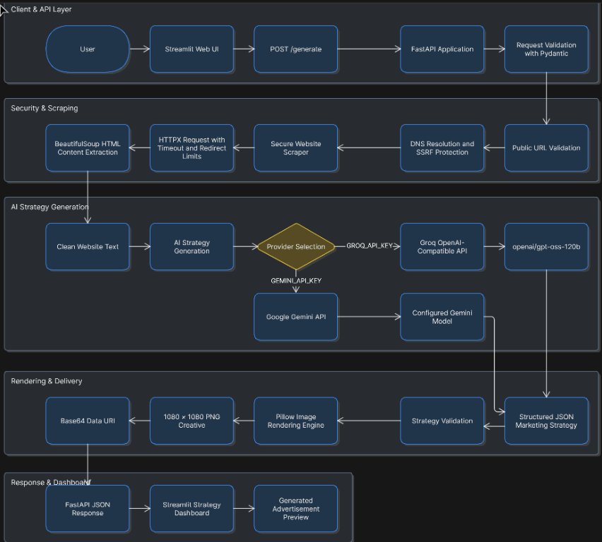
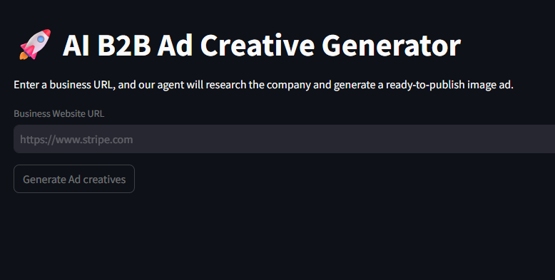

# AI B2B Ad Creative Generator

Production-oriented AI platform for transforming a public business website into a complete B2B advertising creative:

- company and audience intelligence
- AI-generated campaign strategy
- headline, value proposition, and call-to-action copy
- branded 1080 x 1080 social creative
- browser-based Streamlit workspace
- containerized FastAPI inference service

The platform combines controlled web acquisition, structured LLM generation, deterministic image rendering, and health-aware container orchestration.

## Product Architecture

```text
┌──────────────────────┐       HTTP/JSON        ┌────────────────────────┐
│  Streamlit UI        │ ─────────────────────▶ │  FastAPI API            │
│  Port 8501           │                        │  Port 8000              │
└──────────────────────┘                        └───────────┬────────────┘
                                                            │
                         ┌──────────────────────────────────┼────────────────────────┐
                         │                                  │                        │
                         ▼                                  ▼                        ▼
                Public website                    Groq / Gemini LLM       Pillow renderer
                acquisition layer                  strategy generation      PNG + Base64
```

### Core components

| Component | Responsibility | Technology |
|---|---|---|
| Presentation layer | User input, progress state, strategy display, creative preview | Streamlit |
| API layer | Validation, orchestration, health probes, error contracts | FastAPI + Pydantic |
| Acquisition layer | Public website retrieval, HTML extraction, redirect control | HTTPX + BeautifulSoup |
| Intelligence layer | Structured campaign strategy generation | Groq or Google Gemini |
| Rendering layer | Deterministic square ad generation | Pillow |
| Runtime layer | Reproducible services, health-aware startup, restart policy | Docker Compose |

### Architecture flow

```text
User
  ↓
Streamlit Web UI
  ↓
POST /generate
  ↓
FastAPI Application
  ↓
Pydantic Request Validation
  ↓
Public URL Validation
  ↓
DNS Resolution and SSRF Protection
  ↓
Secure Website Scraper
  ↓
HTTPX Request with Timeout and Redirect Limits
  ↓
BeautifulSoup HTML Content Extraction
  ↓
Clean Website Text
  ↓
AI Strategy Generation
  ↓
Provider Selection
  ├── GROQ_API_KEY → Groq OpenAI-Compatible API → openai/gpt-oss-120b
  └── GEMINI_API_KEY → Google Gemini API → Configured Gemini Model
  ↓
Structured JSON Marketing Strategy
  ↓
Strategy Validation
  ↓
Pillow Image Rendering Engine
  ↓
1080 × 1080 PNG Creative
  ↓
Base64 Data URI
  ↓
FastAPI JSON Response
  ↓
Streamlit Strategy Dashboard
  ↓
Generated Advertisement Preview
```

### Architecture diagram



The architecture separates presentation, API orchestration, secure website acquisition, model inference, and deterministic creative rendering. Provider credentials are injected at runtime and never embedded in the application source.

## Project Demo

The demo flow is intentionally short:

```text
Enter a public business URL
  ↓
Select "Generate Ad creatives"
  ↓
Website content is acquired and normalized
  ↓
The selected LLM generates structured campaign strategy
  ↓
Pillow renders the final square creative
  ↓
Strategy metadata and advertisement preview appear in the dashboard
```

### Streamlit workspace



The Streamlit workspace provides a focused operator experience: a single URL input, one generation action, a business profile and campaign strategy panel, and a ready-to-publish creative preview.

## Feature Set

- Public URL validation with DNS/IP safety checks.
- SSRF protection against loopback, private, reserved, and local network addresses.
- Bounded redirects with re-validation at every hop.
- HTML-only acquisition with response-size and timeout limits.
- Strict structured JSON strategy contract.
- Provider abstraction for Groq and Google Gemini.
- Configurable high-capability Groq model.
- 1080 x 1080 PNG output with wrapped typography and font fallback.
- Liveness endpoint: `GET /health`.
- Readiness endpoint: `GET /ready`.
- Explicit HTTP error semantics:
  - `400` invalid input or website acquisition failure
  - `502` upstream AI provider failure
  - `503` missing provider configuration
  - `500` unexpected internal failure
- Non-root container users.
- Docker health checks and `restart: unless-stopped`.
- Runtime-only secret injection.

## Repository Layout

```text
.
├── app.py                 # Streamlit presentation layer
├── main.py                # FastAPI application and orchestration
├── ai_engine.py           # Website acquisition and LLM strategy generation
├── image_engine.py        # Pillow-based creative renderer
├── requirements.txt       # Pinned Python dependencies
├── Dockerfile             # API production image
├── docker-compose.yml     # API + UI deployment topology
├── ui/
│   └── Dockerfile         # Streamlit production image
├── .env.example           # Non-secret configuration template
└── .gitignore             # Secret and build-artifact exclusions
```

## Quick Start

### 1. Create an isolated environment

PowerShell:

```powershell
Set-Location "C:\Users\Lenovo\Desktop\AI-Ad-Intelligence"
py -3.11 -m venv .venv
.\.venv\Scripts\Activate.ps1
python -m pip install --upgrade pip
python -m pip install -r requirements.txt
```

### 2. Configure a provider

Create a local `.env` file from the template:

```powershell
Copy-Item .env.example .env
notepad .env
```

For Groq:

```env
GROQ_API_KEY=<runtime-secret>
GROQ_MODEL=openai/gpt-oss-120b
```

For Google Gemini:

```env
GEMINI_API_KEY=<runtime-secret>
GEMINI_MODEL=gemini-2.5-pro
```

Never commit `.env`, API keys, or provider credentials. The provided `.env.example` intentionally contains blank values.

### 3. Run the API

```powershell
.\.venv\Scripts\python.exe -m uvicorn main:app --host 0.0.0.0 --port 8000
```

### 4. Run the UI

In a second terminal:

```powershell
$env:API_URL="http://127.0.0.1:8000/generate"
.\.venv\Scripts\python.exe -m streamlit run app.py --server.address 0.0.0.0 --server.port 8501
```

Open <http://localhost:8501>.

## Container Deployment

Docker Desktop or a compatible Docker Engine is required.

```powershell
Set-Location "C:\Users\Lenovo\Desktop\AI-Ad-Intelligence"
docker compose up --build -d
```

Inspect service state:

```powershell
docker compose ps
docker compose logs -f api
docker compose logs -f ui
```

Stop the stack:

```powershell
docker compose down
```

The API is exposed on port `8000`; the Streamlit UI is exposed on port `8501`. For a LAN deployment, bind the UI to the host address and expose only the UI publicly where possible.

## API Contract

### `GET /health`

Liveness probe. Does not require provider credentials.

```json
{
  "status": "ok"
}
```

### `GET /ready`

Readiness probe. Returns `503` until a provider key is injected.

```json
{
  "status": "ready"
}
```

### `POST /generate`

Request:

```json
{
  "url": "https://stripe.com"
}
```

Response:

```json
{
  "strategy": {
    "company_name": "Stripe",
    "target_audience": "Businesses building online payment flows",
    "ad_headline": "Power Your Global Commerce",
    "ad_subtext": "Scale payments and financial infrastructure with a unified platform.",
    "cta": "Book a Demo",
    "brand_color": "#0A2540"
  },
  "image_base64": "data:image/png;base64,..."
}
```

## Security and Reliability Model

### Secret management

Provider credentials are read from environment variables at runtime:

- `GROQ_API_KEY`
- `GEMINI_API_KEY`

Secrets are not embedded in Python, Dockerfiles, Compose defaults, or documentation.

### SSRF controls

The acquisition layer:

1. accepts only `http` and `https`;
2. resolves hostnames before requesting;
3. rejects non-global IP addresses;
4. revalidates every redirect destination;
5. caps redirects at four hops;
6. rejects non-HTML content;
7. rejects responses larger than 2 MB;
8. applies connection and total request timeouts.

### Runtime controls

- API calls execute provider SDK work in a thread pool to avoid blocking the async event loop.
- Containers run as an unprivileged user.
- Compose enables `no-new-privileges`.
- Health checks gate UI startup on API readiness.
- Restart policy recovers from process-level failures.

## Operational Configuration

| Variable | Default | Description |
|---|---|---|
| `GROQ_API_KEY` | empty | Groq runtime credential |
| `GROQ_MODEL` | `openai/gpt-oss-120b` | Groq strategy model |
| `GEMINI_API_KEY` | empty | Google Gemini runtime credential |
| `GEMINI_MODEL` | `gemini-2.5-pro` | Gemini strategy model |
| `API_URL` | `http://localhost:8000/generate` | UI-to-API endpoint |

## Validation

Run the lightweight checks before deployment:

```powershell
.\.venv\Scripts\python.exe -m compileall -q .
docker compose config
```

Runtime probes:

```powershell
Invoke-WebRequest http://localhost:8000/health
Invoke-WebRequest http://localhost:8000/ready
Invoke-WebRequest http://localhost:8501/_stcore/health
```

## Production Checklist

- [ ] Inject a valid provider key through a secret manager or deployment environment.
- [ ] Rotate any credential previously pasted into chat, logs, or shell history.
- [ ] Confirm `/ready` returns `200`.
- [ ] Confirm the configured model is available to the provider account.
- [ ] Keep the API behind an authenticated gateway or private network where possible.
- [ ] Add TLS termination at the reverse proxy or ingress layer.
- [ ] Restrict public exposure to the UI or gateway rather than the internal API.
- [ ] Configure centralized logs and alerting for `502`, `503`, and repeated `400` responses.
- [ ] Pin and regularly update dependencies through a controlled review process.
- [ ] Build and scan container images before publishing them.

## Technology Stack

- Python 3.11
- FastAPI
- Uvicorn
- Pydantic
- HTTPX
- BeautifulSoup4
- Groq OpenAI-compatible API
- Google Generative AI SDK
- Pillow
- Streamlit
- Docker Compose

## License

This project is licensed under the [MIT License](LICENSE).
