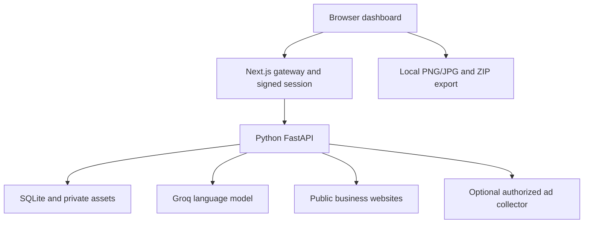

# Signal Studio — B2B Ad Creative Agent

An editable full-stack creative workspace built with **Next.js, React, Python/FastAPI, Groq, SQLite and Pillow**.

**Start with [START_HERE.md](START_HERE.md)** for VS Code setup and local commands. See [DEPLOYMENT.md](DEPLOYMENT.md) for Render and Vercel, [the original product requirements](docs/PROJECT_REQUIREMENTS.md), and [the implementation matrix](docs/IMPLEMENTATION.md).

## Included

- Modern responsive dashboard, campaigns, creative library, brand kit and source evidence workspace.
- Website or manual business input; multi-page research; editable profile with quoted claims.
- Competitor suggestions, confirmation, official-library links and source-linked ad imports.
- LLM-assisted insight reports, explicit coverage gaps and platform-specific creative briefs.
- Approval gates, original branded image layouts, multiple ratios and configurable variations.
- Copy/colour/treatment edits, AI copy revisions, favourites, approvals and saved version history.
- PNG/JPG and campaign ZIP export with suggested copy, report, checks and provenance.
- Private assets and persistent projects; server-side owner checks and optimistic revisions.
- Password-protected workspace with signed HTTP-only sessions, a protected Python gateway and durable login-attempt limits.
- Docker/Compose, Render configurations, Vercel configuration, setup scripts and tests.

## Architecture



Render can run both services in one Docker container with a persistent disk. Vercel hosts only the Next.js layer; a separately deployed Python service stores the data. Browser requests remain same-origin, and the service token never reaches the browser.

## Repository layout

```text
app/                    Next.js pages and authenticated API routes
components/             Dashboard, guided campaign workflow and login UI
lib/                    Domain types, image layouts, exports and session/gateway code
python/app/             FastAPI routes, Groq agent, crawler, storage and Pillow renderer
python/tests/           API, ownership, provenance, image and export tests
scripts/                Local setup, dual-server launcher and frontend tests
deploy/                 Container launcher and separate Python-host configuration
docs/                   Original requirements, scope matrix and collector contract
Dockerfile              Full-stack Render/container image
docker-compose.yml      Local full-stack deployment with persistent data
render.yaml             Full-stack Render blueprint
vercel.json             Next.js frontend deployment settings
.env.example            Configuration names only; no credentials
```

## Checks

```sh
npm ci
npm run typecheck
npm test
npm run build
python -m pip install -r requirements-dev.txt
python -m pytest -q
python scripts/integration_test.py
```

Builds do not need API keys. Live LLM calls require the runtime Groq key. `scripts/doctor.mjs` checks local setup without printing secrets.

## Scope and deployment status

This package is a working first release, **not every requirement in the PRD completed**. See the matrix for dependencies and gaps. In particular, built-in universal ad-library collection, vision analysis, diffusion/photo generation, agency roles, custom fonts and full platform-policy compliance remain incomplete.

The separately hosted ChatGPT example is at https://signal-studio-koushik.spunkyhare3.chatgpt.site and requires ChatGPT sign-in. That example uses a different hosting adapter. **This ZIP uses the Python backend and is designed for your own Render/Vercel deployment.** No Render or Vercel account has been provisioned by this package.

## Credentials and data

Run `npm run setup` to create an ignored local `.env.local` with fresh random secrets. Add a replacement Groq key there, or configure secrets in your hosting provider. The key previously pasted into chat is excluded from all source and downloads and should be revoked.

Keep `WORKSPACE_ID` stable to retain ownership of existing records. Changing `SESSION_SECRET` signs out current sessions. The password login is a single-owner workspace, not a multi-tenant membership or agency-role system.

SQLite and assets require a persistent disk. The Python service is intended for one instance. For horizontal replicas, replace SQLite/local assets with PostgreSQL/object storage and add a durable job queue.

MIT © 2026 Koushik Biswas. See [LICENSE](LICENSE).
